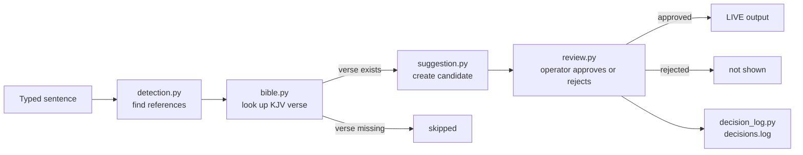

# Wordit.ai


**Wordit.ai** suggests Bible references from a sermon on screen, and a church operator approves which verses go live.

Created by Stephen Wiendoh Ntah (NWstevo), CODE University of Applied Sciences, Berlin.

---

## Key Features at the moment

Wordit.ai is currently in phase 1. It runs in the terminal and uses a text as sample input for the preacher's voice or sermon.

- Finds Bible references in a sentence, such as "Romans 8:28" or "John chapter 3 verse 16".
- Looks up each verse using the King James Version of the Bible.
- Shows each suggestion to the operator, who decides to either approve or reject it.
- Shows approved verses as live output.
- Logs every decision in a log file.

Nothing is displayed on the screen without the operator's approval.

## Requirements

- Python 3.11 or newer
- Git

## Installation

```bash
git clone https://github.com/NWstevo/Wordit.ai.git
cd Wordit.ai
python3 -m venv .venv
source .venv/bin/activate
pip install -e ".[dev]"
```

## Getting started

Start Wordit.ai and type a sentence as the preacher would say it:

```bash
python -m wordit
```

```text
Type what the preacher says. Press Enter on an empty line to finish.
Preacher says: Turn with me to John 3:16
Suggestion: John 3:16
Verse (KJV): For God so loved the world, that he gave his only begotten Son, ...
Heard: "Turn with me to John 3:16"
Approve (a) or Reject (r)? a
LIVE: John 3:16 (KJV) For God so loved the world, ...
```

Press Enter on an empty line to stop. Each decision is saved in `decisions.log`.

## Troubleshooting

**`FileNotFoundError: ... 'data/kjv.json'`**: run Wordit.ai from the project folder (`cd Wordit.ai`), because it looks for the Bible data relative to where you start it.

## Running the tests

```bash
pytest
```

The test suite has 55 tests, runs in under a second, and covers 98 % of the code.
To see which lines are covered, run:

```bash
pytest --cov=wordit --cov-report=term-missing
```

The two uncovered lines only start the program when a module is run directly
(`if __name__ == "__main__":`). The code they call is tested.

| Test type | Example in this project |
| --- | --- |
| Unit | Parsing "John 3:16" into book, chapter and verse |
| Integration | Converting the KJV source file and reading it back with `Bible` |
| End-to-end | A typed sentence travelling through the whole program to a live verse |
| Labelled dataset | 25 real sermon sentences checked against the detector |

The tests replace the keyboard and the clock with fakes, so they run without a
person and give the same result every time.

## Code quality tools

Every push runs these checks on GitHub Actions (see the CI badge at the top):

| Tool | Checks |
| --- | --- |
| Black | Consistent formatting |
| Pylint | Code style and common mistakes |
| mypy | Type hints match how values are used |
| pytest with pytest-cov | All tests pass, and how much code they cover |

Run the same checks locally before committing:

```bash
black src tests
pylint src
mypy src
pytest
```

## How it works



A sentence is searched for Bible references. Each reference is looked up in the
King James Version; references to verses that do not exist are skipped. Every
remaining reference becomes a candidate that the operator approves or rejects.
Only approved verses go live, and every decision is written to `decisions.log`.

## Future Work (phase 2)

Planned: speech recognition, so Wordit.ai listens to the sermon directly.

Planned: NDI output for OBS Studio, vMix, EasyWorship and ProPresenter.

---

## Contributing

We welcome contributions from developers, media directors, and tech enthusiasts passionate about enhancing church media production. Please read our [Contributing Guidelines](CONTRIBUTING.md) to get started.

## License

Distributed under the [MIT License](LICENSE).
