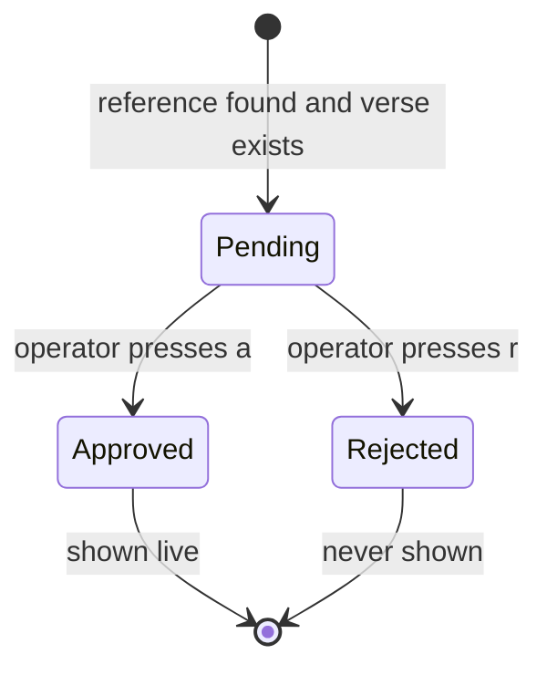

# How Wordit.ai works

This page explains the ideas and functioning behind Wordit.ai: how it finds a Bible reference in
what a preacher says, why a person approves every verse, and why phase 1 works
with typed text. It is for operators, reviewers and developers who want to
understand why Wordit.ai behaves the way it does. To learn how to use it, follow
the [tutorial](tutorial.md).

## The idea in one paragraph

A preacher mentions a Bible passage while delivering a sermon, and the congregation 
should see it on screen within seconds. Wordit.ai listens for references in 
each line of the sermon, looks the verse up in the King James Version of the Bible, 
and shows it to the media operator. The operator decides whether it goes live or not. 
Wordit.ai does the searching; a person keeps the final say.

## How a reference is found

Wordit.ai uses a pattern that works like a stencil with two parts:

1. **A book name**, one of the 66 books of the King James Version, in any
   capitalisation.
2. **The shape of a reference** after the book name, a chapter number or the word 
"chapter" followed by a number, then a colon (:) or the word "verse", 
then a verse number. The word "from" before "verse" is also allowed.

Only text that fits both parts is a reference in the current version. 
Wordit.ai checks the line from left to right: at each position it tries to 
fit the whole stencil, and if any part does not fit, it moves on by one character.

| The preacher says | Found | Why |
| --- | --- | --- |
| Turn with me to John 3:16 | John 3:16 | Book name, then chapter and verse |
| Turn to 1 John 1:9 | 1 John 1:9 | "1 John" is one book name; it starts at the "1", before "John" could match |
| We start at 10:30 | nothing | "10:30" has the shape of a reference, but no book name before it |
| Read 2 Romans 8:28 | Romans 8:28 | There is no book called "2 Romans", so the "2" is ignored |
| Psalm 23:1 | nothing | The KJV name is "Psalms"; variants are not listed yet |

Because the stencil only accepts names from the book list, Wordit.ai cannot invent
a book, and times or phone numbers are never mistaken for references. The cost is
that variants such as "Psalm" or "First John" are missed. See
[supported reference formats](reference-formats.md) for the full list.

## Why only verses that exist

A reference can have the right shape and still point nowhere: John 3 has 36
verses, so "John 3:99" does not exist. After finding a reference, Wordit.ai looks
the verse up in the King James Version. If the verse does not exist, the reference
is dropped, and the operator sees "No valid Bible reference found in the text."
Nothing that cannot be looked up ever reaches the operator, or the screen.

## Why a person approves every verse

A wrong verse on screen is the worst thing that can happen in a service. The
congregation reads it, and the preacher is interrupted. Detection will sometimes be
wrong, so phase 1 never lets a verse go live on its own.

Every suggestion starts as **pending**. Only the operator can change that:

Three choices keep this fast enough for a live service:

- **The verse text is shown before the decision**, so the operator checks the
  actual words, not only the reference.
- **One key decides.** Approving sends the verse live straight away, with no
  separate send step. Operators often run cameras at the same time.
- **Any other key asks again.** A suggestion is never decided by accident.

Every decision is written to `decisions.log`, so the team can review a service
afterwards.

Approving every verse is slower than full automation. It is the right trade-off
for phase 1, because the operator can catch the detector's mistakes, and the log
shows how often that happens. That evidence is needed before any step towards
automatic display.

## Why typed text first

In a real service, Wordit.ai should listen to the preacher's voice. Phase 1 starts
with typed text instead, for two reasons:

- **The detector only needs text.** Speech recognition turns audio into text, so it
  can be added in front of the detector later without changing the detector.
- **Text makes testing reliable.** The same sentence always gives the same result,
  so the tests can check hundreds of cases in under a second. Audio would make
  tests slow and less predictable.

Keeping each part to one job (finding references, looking up verses, asking the
operator, writing the log) is what makes this possible. The
[architecture diagram](../README.md#how-it-works) shows how the parts connect.

## Limits of phase 1

Wordit.ai does not yet recognise name variants, spoken numbers or verse ranges,
uses only the King James Version of the Bible, and has no live display or speech input. 
The [risk register](risks.md) lists what this means and how each risk is handled.